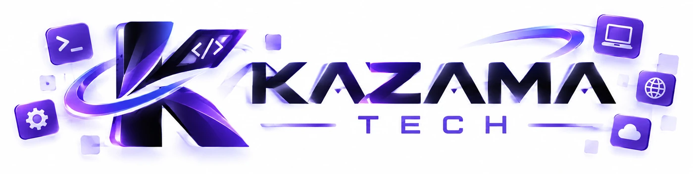

<div align="center">



# KzRDP

**Desktop Windows sampai 6 jam, gratis — GitHub Actions + XyDesk Remote.**

Dikembangkan oleh **Kazama Tech**

</div>

---

> **Menjalankan RDP?** [`SETUP.md`](SETUP.md) · **Memasang dashboard?** [`SETUP-WEB.md`](SETUP-WEB.md) · **Bot Telegram + token?** [`SETUP-BOT.md`](SETUP-BOT.md) · **Tunnel domain?** [`SETUP-TUNNEL.md`](SETUP-TUNNEL.md)
> File ini hanya penjelasan: apa itu KzRDP, cara kerjanya, dan isi folder.

## Cara kerja

```
Run workflow ─► [1] verifikasi token + email + GitHub ─► server mengirim paket skrip ─► [2] siapkan sistem
                                                                                          │
   Telegram DM (alamat, user, password) ◄── [3] kirim data ◄──────────────────────────────┘
                                                  │
                         [4] opsi tambahan ─► [5] sesi aktif ─► [6] simpan sesi ─► selesai
```

- **Repo publik hanya berisi satu workflow tipis** (`template/`). Semua skrip build ada di server (`web-next/bundle/`) dan diunduh **hanya setelah** token, email, dan username GitHub pemilik token terverifikasi. Jika langkah verifikasi dihapus, tidak ada skrip yang bisa dijalankan.
- Alamat koneksi dan password **dikirim ke DM Telegram** pemilik token, tidak ditulis di log publik. Password dibuat acak bila secret `RDP_PASSWORD` kosong.
- Jalur akses: `tailscale` (privat), `tunnel` (domain publik lewat server bore milik sendiri), atau `portmap`.
- Dashboard web hanya untuk status, sisa waktu, tombol Stop, dan membuat token. Link unduh XyDesk hanya tampil selama sesi berjalan (log workflow, Telegram, dan dashboard).

## Input workflow

| Input | Keterangan |
| --- | --- |
| `token` · `github` · `email` | Wajib; harus milik orang yang sama (token dibuat di dashboard dan diverifikasi di Telegram) |
| `rdp_user` | Username Windows (default `kzadmin`) |
| `runner` | `windows-2025` (default) atau `windows-2022` |
| `durasi_menit` | Angka 10–360 (maks 6 jam, termasuk waktu persiapan) |
| `akses` | `tailscale` · `tunnel` · `portmap` |
| `xydesk` `microphone` `samp` `devtools` `storage_boost` `win10` `ekstra` `grafis` … | Checkbox opsi tambahan |

## Struktur

```
template/                 isi repo publik: .github/workflows/rdp-6h.yml + README singkat
web-next/                 dashboard + server (privat; Next.js · OpenNext · Cloudflare D1)
  bundle/scripts/           skrip build: lib/ · phases/ · setup/ · session/
  bundle/assets/            wallpaper dan konfigurasi sesi
  tools/embed-bundle.mjs    mengemas bundle menjadi src/generated/rdp-bundle.json
  src/app/                  halaman + API (App Router); tema di theme.css (hitam + ungu)
  src/components/           landing/ · dashboard/ · locale-provider
  src/lib/                  core/ auth/ github/ workflow/ rdp/ config/ (brand.ts) routing/ access/ community/ i18n/
docs/                     catatan teknis + docs/branding (banner Kazama Tech transparan, teks putih)
integrasi-xydesk/         paket integrasi untuk aplikasi XyDesk Remote
```

## Catatan keamanan

- Gerbang build = token terverifikasi + email + username GitHub yang cocok; tiga kali salah dalam satu jam mengunci token itu.
- Workflow memodifikasi kebijakan Windows (termasuk UAC dan akun administrator): gunakan untuk sesi sekali pakai, bukan mesin kerja utama.
- Penggunaan Actions di luar tujuan CI/CD bisa melanggar ketentuan GitHub dan berisiko membuat akun dibatasi. Tunnel publik menambah risiko serangan tebakan password pada alamat yang terbuka; rahasiakan alamatnya.

---

© KzRDP · Kazama Tech
